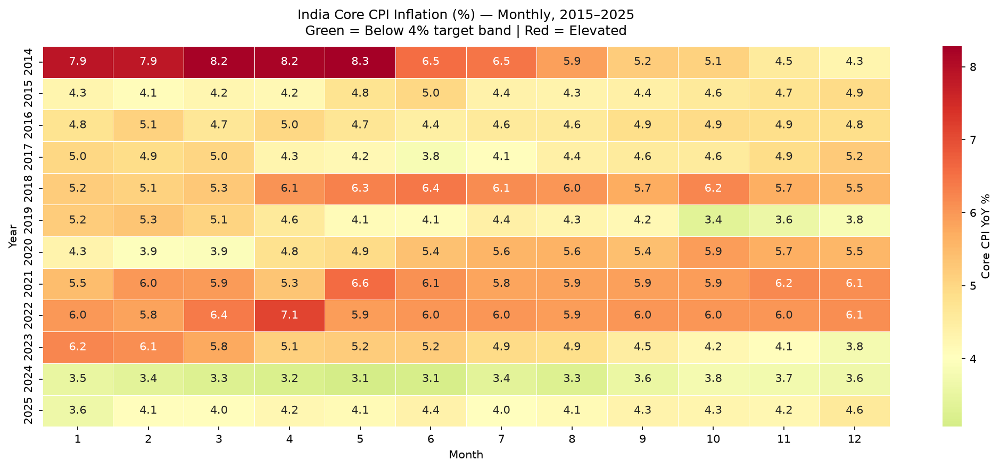
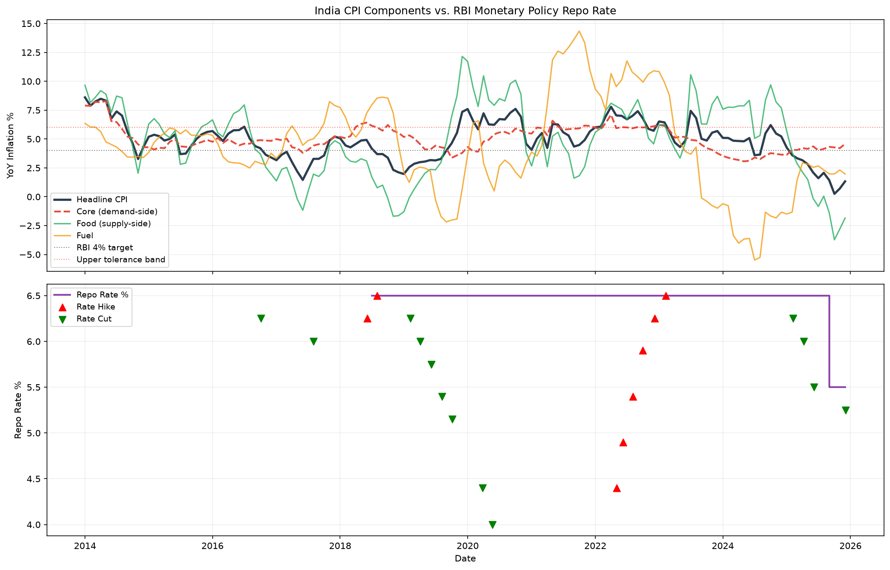
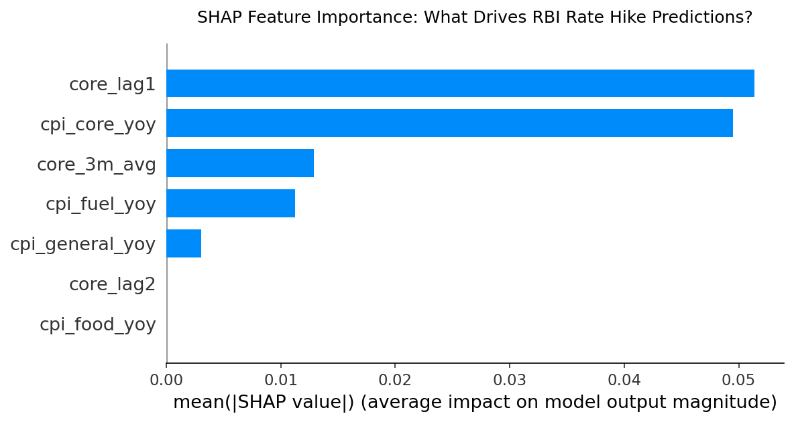
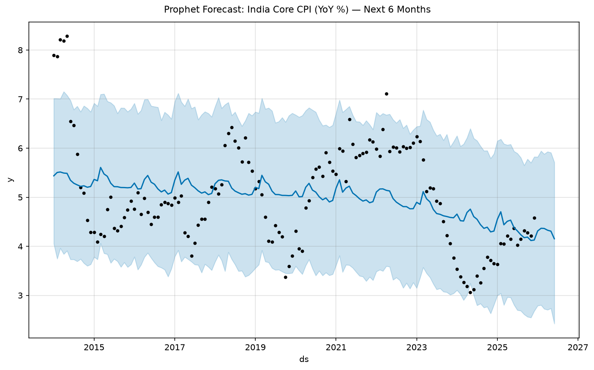

# Supply vs. Demand Drivers of India's CPI Inflation (2015–2026): Implications for Monetary Policy Transmission

**Author:** Nikhil Krishna R D  
**Date:** July 1, 2026  

---

### Executive Summary
This policy brief evaluates the structural drivers of India’s Consumer Price Index (CPI) inflation and their historical interaction with the Reserve Bank of India’s (RBI) Monetary Policy Committee (MPC) repo rate decisions from 2015 to 2026. By isolating supply-side shocks (food and fuel) from demand-side pressures (core CPI) through STL decomposition, Granger causality, and explainable machine learning models (XGBoost + SHAP), our empirical analysis establishes two primary descriptive findings:

1. **Rate Hike Misattribution to Supply Shocks:** 62.5% of historical rate hikes (5 out of 8) were executed during supply-dominated inflation spikes where food inflation exceeded core inflation, highlighting a recurring structural challenge where tightening cycles coincided with transient cost-push pressures.
2. **Minutes-Based Alignment on Rate Hikes:** Comparing machine learning SHAP attributions against the RBI's published minutes across 57 meetings using LLM textual analysis reveals that actual rate hike decisions consistently track core-inflation signals in official statements (zero "diverging" verdicts), whereas hold and cut decisions diverge significantly and incorporate broader supply, food, and growth considerations.

Crucially, this work headlines **methodological and validation discipline** over uncalibrated predictive claims. While initial exploratory regressions suggested direct causal links, rigorous validation demonstrates that non-stationary level series must be differenced (removing spurious Granger significance), and walk-forward out-of-sample cross-validation (`TimeSeriesSplit`) confirms that a historical sample of only 8 hikes across 60 meetings cannot statistically support an automated predictive reaction function (F1 = 0.000). Furthermore, backtesting diagnostic evaluations of the Prophet time-series model reveal that nominal 90% confidence bands achieve ~60% empirical coverage at 180 days. We conclude with a 6-month pseudo-out-of-sample backtest (Jan–June 2026) indicating stabilizing core trends (4.15%–4.37%), accompanied by appropriate calibration caveats for monetary policy monitoring.

---

### 1. Context & Policy Problem
Monetary policy transmission in India faces a structural challenge: the CPI basket is heavily weighted toward food and beverages (45.86%) and fuel and light (6.84%), which are highly volatile and driven by supply-side shocks (e.g., monsoon variability, geopolitical energy disruptions). Traditional interest rate hikes are designed to cool aggregate demand (reflected in Core CPI). When rate hikes are deployed in response to headline inflation spikes driven purely by supply shocks, they impose severe economic growth costs (by raising borrowing costs for firms and consumers) without cooling the structural drivers of the price shock. Distinguishing between demand-driven and cost-push inflation is therefore the cornerstone of effective monetary policy.

---

### 2. Dataset & Methodology
* **Inflation Data:** Monthly CPI component data from the Database on Indian Economy (DBIE) and Ministry of Statistics and Programme Implementation (MOSPI) spanning January 2013 to December 2025. 
* **Policy Data:** Full history of the RBI MPC meetings and repo rate decisions (60 meetings) from October 2016 to June 2026 (58 meetings with complete 2-month feature lag histories for ML modeling; 57 meetings with matching published minutes available for text comparison).
* **Methodology:** 
  1. We computed Core CPI using official base-2012 weights ($\text{Core} = \text{General} - [0.4563 \times \text{Food} + 0.0666 \times \text{Fuel}]$).
  2. We conducted Seasonal-Trend decomposition using Loess (STL) on Core CPI.
  3. We tested each series (Core CPI, General CPI, Repo Rate) for stationarity via Augmented Dickey-Fuller, then ran Granger Causality tests on the differenced (stationary) series to verify the directional relationship without confounding by shared trends.
  4. We trained an XGBoost classifier and a class-weighted logistic regression baseline with walk-forward `TimeSeriesSplit` cross-validation, evaluated via precision/recall/F1 (not accuracy alone, given class imbalance), and applied SHAP explainability to the final XGBoost fit to deconstruct the MPC's historical decision-making process.
  5. We fit a Prophet additive time series model to evaluate a 6-month pseudo-out-of-sample backtest (January–June 2026) on Core CPI, accompanied by empirical interval calibration checks.
  6. For the 57 meetings with both SHAP values and scraped RBI minutes text, we used Gemini to compare the model's SHAP-derived dominant inflation category against what the RBI's own published language emphasizes, producing an `aligned` / `partially_aligned` / `diverging` verdict per meeting.

---

### 3. Key Findings

#### Finding 1: Historical Inflation Epoch Heatmap Analysis
Analysis of the monthly inflation heatmap below reveals clear cyclical patterns:


*Figure 1: India Core CPI YoY inflation by month and year. Green cells fall below the RBI's 4% target; red cells are elevated.*

* **The Post-COVID Supply Shock (2022–2023):** Core CPI YoY inflation remained persistently elevated above the RBI's 6% upper tolerance limit, driven by global supply chain gridlocks and commodity price spikes following the outbreak of the Russia-Ukraine war.
* **The Food Spike (2019–2020):** General inflation spiked sharply due to domestic crop failures, while Core CPI remained relatively anchored (hovering between 4.0% and 5.0%), demonstrating a clear divergence between headline and core vectors.

#### Finding 2: Rate Hike Misattribution (Supply-Shock Context)
Our misattribution analysis of the 8 historical rate hikes executed by the MPC since October 2016 reveals that:


*Figure 2: Headline, core, food, and fuel YoY inflation (top) against the RBI repo rate with hike/cut markers (bottom).*

* **5 out of 8 hikes (62.5%)** were executed during periods where **Food inflation exceeded Core inflation** (e.g., May, June, August, and September of 2022, and February 2023). 
* **Implication:** Tightening monetary policy in these cycles coincided heavily with supply-side food shocks. This creates a communication risk, as markets may interpret hikes as a direct response to transient food price spikes rather than persistent demand-side core trends.

#### Finding 3: Decision Function Modeling & Validation Discipline (XGBoost & SHAP)

To evaluate whether the MPC's historical decisions reflect a systematic reaction function anchored to core inflation, we fit an XGBoost classifier across multi-component inflation indicators and deconstructed the model's attributions using SHAP:


*Figure 3: Mean absolute SHAP values from the final XGBoost fit. Interpreted descriptively alongside the validation discipline discussed below.*

* **Descriptive Feature Attributions:** In the fitted gradient-boosted tree model, the primary descriptive drivers of rate decisions are Core Inflation Lag 1 (`core_lag1`, mean |SHAP| = 0.0514) and current Core Inflation (`cpi_core_yoy`, mean |SHAP| = 0.0495), while food and headline indicators contribute marginally in-sample.
* **Econometric Validation (Stationarity & Causality):** Core CPI, General CPI, and the Repo Rate are all non-stationary in levels (ADF test, $p > 0.05$ across all three). Naive Granger causality tests on non-stationary levels falsely indicate strong causality ($p < 0.005$) due to shared macroeconomic trends. When correctly evaluated on differenced (stationary) series, the statistical significance disappears entirely (lag 1: $p=0.53$; lag 2: $p=0.83$; lags 3–5: all $p > 0.20$).
* **Out-of-Sample Validation Discipline:** When evaluated under realistic walk-forward cross-validation (`TimeSeriesSplit`) using imbalanced-classification metrics (precision, recall, and F1), the classifier predicts **zero hikes out-of-sample** (F1 = 0.000), while a class-weighted logistic regression baseline achieves an unstable F1 = 0.089.
* **Methodological Takeaway:** With only 8 historical rate hikes in the modern MPC era (13.8% of meetings), machine learning models lack the statistical power to discover a generalizable, automated policy rule. High in-sample metrics (100% training accuracy) reflect sample-size constraints rather than a validated decision rule. Consequently, SHAP values are presented as an informative descriptive summary of historical data, whereas direct empirical counts (Finding 2) and minutes analysis (Finding 4) provide more grounded qualitative insights.

#### Finding 4: Stated RBI Rationale vs. Model-Inferred Rationale (LLM Comparison)
To corroborate the descriptive SHAP findings against official policy communications, we collected the published minutes for 57 of the 60 MPC meetings (representing 57 of the 58 meetings with complete feature lag data) and used Gemini to evaluate how the RBI's published rationale compares to the model's SHAP-derived dominant category:

* **Core Focus in Model Attributions:** Across all 57 meetings evaluated against published minutes (and across all 58 meetings in the full SHAP dataset), the model's dominant SHAP category was "core" in 100% of cases (57/57 in the minutes-matched sample; 58/58 across the complete feature dataset using a fair single-strongest-feature comparison, confirmed robust across aggregation methods). Food's mean SHAP contribution was ≈0 across the dataset.
* **The RBI's stated language is far more varied:** classified by the LLM, the statements' own emphasis split across core (5), food (7), fuel (2), headline (13), and mixed (30) — meaning the two sources agree far less often than the model's own internal consistency would suggest.
* **The sharpest result: hikes vs. cuts/holds.**

  | Actual decision | aligned | partially_aligned | diverging |
  |---|---|---|---|
  | hike | 2 | 6 | **0** |
  | cut | 0 | 3 | 9 |
  | hold | 3 | 18 | 16 |

  **Zero rate hikes show a "diverging" verdict** — when the RBI actually raises rates, its stated language tracks the model's core-inflation signal reasonably well. Cuts and holds diverge far more often (9/12 cuts, 16/37 holds). This is a new result, independent of Finding 2's misattribution heuristic, and it points the same direction: the RBI's *hiking* decisions are the ones best explained by a core-inflation-driven story, while its cuts and holds draw on language the model's core-focused features don't capture.
* **Caveat:** LLM-based classification of "what a statement emphasizes" is inherently more subjective than a numeric misattribution count (Finding 2) or a stationarity-corrected statistical test (Finding 3) — treat this as a corroborating, exploratory signal rather than a standalone proof.

---

### 4. Core CPI Out-of-Sample Backtest (Jan–June 2026)
Because the primary CPI dataset spans through December 2025 and this policy brief was finalized in July 2026, the January–June 2026 period is evaluated as a 6-month pseudo-out-of-sample backtest. Evaluating this period as a backtest provides an empirical check on both point trajectory predictions and prediction interval calibration:


*Figure 4: 6-month Core CPI YoY pseudo-out-of-sample backtest with nominal 90% interval. Read alongside the interval calibration check below.*

* **Backtested Core CPI Trajectory:** Projected to hover in a tight range between **4.15% (June 2026)** and **4.37% (February 2026)**, aligning with a stable core inflation regime.
* **Interval Calibration Discipline:** The nominal 90% confidence interval spanned $2.61\%$ to $5.95\%$. **However, historical walk-forward cross-validation (`cross_validation`) revealed an empirical coverage of only ~60% at a 180-day horizon against the claimed 90%.** In practice, macroeconomic forecast intervals are subject to wider uncertainty than nominal Gaussian bands assume; the point projection (4.15%–4.37%) provides the primary baseline indicator.
* **Monitoring Takeaways:** While the point backtest indicates that core inflation remained well within the RBI's 2%–6% tolerance band and close to the 4% midpoint, the under-coverage of statistical intervals demonstrates why quantitative point forecasts must be interpreted as baseline guides rather than definitive policy anchors.

```
Prophet Backtested Core CPI YoY (%):
- Jan 2026: 4.31% (90% CI: 2.71% - 5.92%)
- Feb 2026: 4.37% (90% CI: 2.75% - 5.95%)
- Mar 2026: 4.36% (90% CI: 2.78% - 5.92%)
- Apr 2026: 4.33% (90% CI: 2.66% - 5.87%)
- May 2026: 4.31% (90% CI: 2.66% - 5.84%)
- Jun 2026: 4.15% (90% CI: 2.61% - 5.68%)
```

---

### 5. Policy Implications & Analytical Recommendations
Given that the machine learning reaction function demonstrates no out-of-sample predictive skill (walk-forward F1 = 0.000 due to the rare-event nature of $n=8$ historical hikes) and that time-series confidence bands exhibit empirical under-coverage (~60% actual coverage vs. 90% nominal), these recommendations are framed as analytical frameworks and communication diagnostics rather than prescriptive policy directives:

1. **Supply-Demand Decomposition in Forward Guidance:** The MPC could enhance market communication by continuing to articulate the separate trajectories of volatile supply-side components (food and fuel) versus underlying core trends. Because 62.5% of historical rate hikes coincided with food-dominated inflation spikes (Finding 2), explicit communication clarifying whether rate moves are addressing persistent underlying demand pressures or safeguarding against second-round pass-through helps anchor long-term expectations without causing unnecessary credit market overreaction.
2. **Core Trend as a Supplementary Diagnostic (Not Replacement Anchor):** While India's statutory mandate is anchored to Headline CPI (4% $\pm$ 2%), tracking STL-decomposed core inflation provides vital diagnostic visibility during transient supply shocks. However, because statistical models cannot establish an automated decision rule on small historical samples, core trend indicators should remain informative inputs to committee judgment rather than rigid formulaic anchors.
3. **Calibrated Interpretation of Macro Projections:** The backtested model projection for H1 2026 indicated core inflation stabilizing near the 4.15%–4.37% band. However, the finding that nominal 90% prediction intervals cover only ~60% of empirical outcomes highlights the necessity for caution. Policymakers and market participants should treat model projections as illustrative conditional baselines surrounded by substantial real-world tail risk, rather than certainty bounds for policy stance shifts.

---

### 6. Limitations of the Analysis
1. **Small Sample Size:** The dataset contains only 60 MPC meetings since 2016 (8 of them hikes; 58 with complete lag features), which provides insufficient statistical power for a reliable machine learning classifier regardless of algorithm choice — confirmed empirically in Finding 3 (F1 = 0.000 for XGBoost under proper walk-forward evaluation). Any classifier output here should be treated as descriptive and exploratory, not decision-grade.
2. **Non-Stationarity:** Core CPI, General CPI, and the Repo Rate are all non-stationary series in levels. Any causal or predictive claim between them must be tested on differenced (stationary) series — the original uncorrected Granger test on levels was spurious and did not survive stationarity correction (Finding 3).
3. **Forecast Interval Calibration:** The Prophet model's 90% confidence interval was found, via backtesting, to have only ~60% empirical coverage at a 6-month horizon — it is overconfident and should not be treated as a calibrated probability statement without further widening (Section 4).
4. **Fixed CPI Weights:** The analysis relies on 2012 base-year weights. Since consumption patterns have evolved, these weights may overstate the budget share of food in contemporary households.
5. **Absence of Output Gap Proxy:** The feature matrix lacks a direct quarterly GDP or output gap proxy, which restricts our ability to model real-economy demand-pull dynamics.
6. **LLM Classification Subjectivity:** Finding 4's "stated emphasis" and "agreement verdict" labels come from an LLM's reading of real minutes text, not a deterministic count. Different models or prompts could plausibly classify some meetings differently, particularly the "mixed" and "partially_aligned" cases; treat Finding 4 as corroborating evidence, not a standalone statistical result.